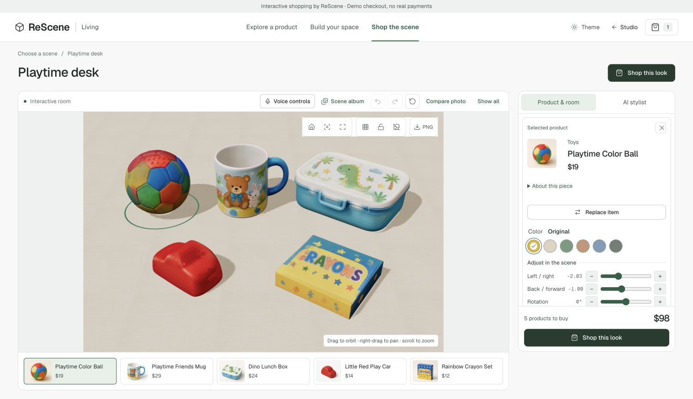
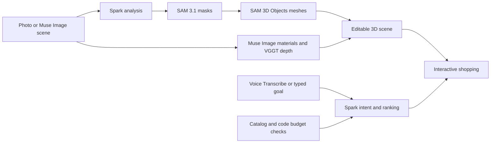

# ReScene

Turn a product photo into an editable, shoppable 3D scene.

ReScene gives sellers a way to turn product photography into an interactive showroom. Shoppers can inspect individual products, try finishes and layouts, and ask a budget-aware AI stylist for combinations made from the available catalog.

[Try the live demo](https://rescene-eta.vercel.app/demo) · [Run locally](docs/JUDGE_SETUP.md) · [Meta models](docs/MODEL_USAGE.md)



*The working shopping demo: selectable textured models, product details, finish controls and a shopping bag.*

## Try it

The public shopping demo needs no account or credentials:

- **[Explore a product](https://rescene-eta.vercel.app/demo/products):** browse photographs, switch to 3D inspection and try a finish.
- **[Build your space](https://rescene-eta.vercel.app/demo/spaces):** arrange products, replace a piece, change lighting and undo the edit.
- **[Shop the scene](https://rescene-eta.vercel.app/demo/scenes):** select products within an environment and collect them in a demonstration shopping bag.

For the AI stylist, open **Quiet workspace**, mark the laptop and notebook as already owned, keep the tumbler and set a $100 merchandise budget. Ask for two different mouse choices. Spark proposes alternatives from the catalog; code checks the subtotal, kept items, compatibility and placement. Preview a look, apply it, then Undo once. The hosted stylist and voice features make real model calls; prepared photos and meshes do not regenerate when browsed.

The current showroom contains 72 approved products and 11 collections, including five distinct chair, drawer, mouse, sofa, shoe and mug variations. Checkout, reviews, specifications and prices are demonstration content. No payments are processed.

## Run the prepared showroom without keys

Install Node.js 22, then:

```sh
git clone https://github.com/jimclydegm/ReScene.git
cd ReScene
npm ci
npm run setup:judge
npm run dev:judge
```

Open **http://127.0.0.1:3000/demo**. Setup downloads approved models from the public GitHub sample release and verifies their hashes. This path needs no database, storage or authentication account. It supports the interactive shopping controls using saved results; AI requests are disabled rather than simulated.

## Run live generation with your own keys

Start Docker, stop the sample server, and run:

```sh
npm run setup:judge -- --live
```

Add only these two external keys to the generated, ignored `.judge/keys.env`:

```dotenv
MODEL_API_KEY=your_meta_model_api_key
FAL_KEY=your_fal_key
```

```sh
npm run dev:judge:live
```

Open **http://127.0.0.1:3000/dashboard**. Local Postgres, private file storage and an isolated reviewer identity replace cloud provisioning. No Neon, Cloudflare, Google OAuth or Vercel credentials are needed. Use your own permitted photo to run analysis, review masks, reconstruct objects, edit and save. Live inference uses your provider balances. A lost response may have been charged; unknown paid submissions are not retried automatically.

The local server binds to loopback and must not be exposed publicly. [Complete setup, persistence and troubleshooting](docs/JUDGE_SETUP.md). A hosted production deployment uses the original [Neon/Auth/R2 setup](docs/SETUP.md).

## How the models work together



- **Muse Spark 1.3:** scene/material understanding, review, voice interpretation and shopping intent/ranking.
- **SAM 3.1:** object segmentation and mask refinement.
- **Muse Image 1.0:** scene/product photography, empty-background plates and material samples.
- **Muse Voice Transcribe 1.0:** prompt dictation, product search and reviewed scene commands.
- **Meta SAM 3D Objects, hosted by fal:** textured object reconstruction and approximate poses.
- **VGGT1B, Oxford/Meta research hosted by fal:** camera/depth evidence for background construction.

The first four use Meta Model API directly. The `openai` npm dependency is a compatible SDK configured for Meta's API, not an OpenAI runtime model. [Exact model IDs, implementation links and hosted-component transparency](docs/MODEL_USAGE.md).

## Engineering

The application is Next.js/TypeScript with React Three Fiber/Three.js. Production uses Vercel Workflow for durable operations, Neon Postgres/Prisma for scenes and receipts, Managed Better Auth for identity, and private Cloudflare R2 for media.

ReScene validates model output, matches masks, fits a shared scene frame, seats objects on supports and checks background clearance. Materials combine observed detail with generated samples; unseen surfaces remain inferred. The shopping engine enumerates compatible combinations and calculates prices in integer cents before Spark ranks them. Applying a combination creates one undo entry.

Publication produces a frozen, read-only snapshot with approved render assets and product fields. Full source photographs, masks and raw provider records stay private. Later draft edits do not modify an existing publication.

[Architecture](docs/ARCHITECTURE.md) · [Data model](docs/DATA_MODEL.md) · [Background clearance](docs/BACKGROUND_CLEARANCE.md) · [Shopping stylist](docs/SHOPPING_STYLIST.md)

## Checks

```sh
npm test
npm run typecheck
npm run build
# Schema validation, lint, tests and production build together:
npm run check
```

The suite covers input and ownership boundaries, durable-request recovery, budget/keep/placement constraints, undo history, scene contracts and graphics operations. Tests use mocked providers or pure computations; they do not submit paid inference. Targeted browser and saved-scene checks complement the suite. [Testing details](docs/TESTING.md).

## Scope and credits

ReScene was started from scratch during the 2026 Meta Global AI Developer Hackathon; the public repository was created October 28. The entry is in the Indie Developer track. Pretrained models and existing open-source libraries are dependencies, not original ReScene inventions.

A single photograph does not establish exact product identity, dimensions, unseen geometry, garment fit or physical material properties. Reconstructions and finish previews are approximate. The showroom is a working demonstration, not a merchant inventory or payment system.

Original application code is currently unlicensed, at the author's choice. Generated media, procedural assets and third-party components have separate terms. [Assets, provenance and attribution](docs/ATTRIBUTION.md), including Unslop by Damir Sokolovsky.
