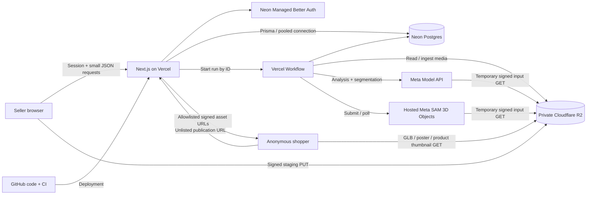

# ReScene system architecture

Architecture target, October 29, 2026. The app/auth/database, durable analysis/reconstruction, mask review, and saved object-transform editor are implemented. Product editing and publication remain planned. Visual browser QA is pending. See [SETUP.md](SETUP.md) for verified deployment/access status, [PLAN.md](PLAN.md) for scope, and [DATA_MODEL.md](DATA_MODEL.md) for constraints.

## 1. System boundaries



One Next.js app hosts pages, server-rendered shells, Route Handlers, auth proxy, and durable orchestration. The browser renders 3D; it does not run model inference. Large media live in R2, relational data in Neon. The GPU host runs Meta's reconstruction model and returns artifacts to be copied into our storage.

No Python service, Redis, WebSockets, separate database REST service, or Cloudflare Worker is needed initially. A self-hosted SAM 3D GPU runner is a contingency, not an additional system to build by default.

## 2. Frontend

Use [Next.js App Router](https://nextjs.org/docs/app), TypeScript, and React. The implemented foundation uses plain CSS; Tailwind/shadcn remain optional for the editor. Keep authentication, list pages, and initial data loading on the server. Dynamically import WebGL components so they do not enter server rendering.

Use [React Three Fiber](https://r3f.docs.pmnd.rs/getting-started/introduction) over [Three.js](https://threejs.org/docs/) with Drei controls/loaders. Zustand holds draft scene state and selection; React component state holds transient form UI. Fetch/poll server state using one approach (SWR or a small fetch hook), not multiple query libraries.

### Screens

| Route | Main content |
| --- | --- |
| `/` | Short explanation, sample viewer, create-scene action |
| `/auth/sign-in`, `/auth/sign-up` | Managed-auth forms, error/loading states |
| `/dashboard` | Owned scenes, status, thumbnail, create action |
| `/scenes/new` | Title and photo upload |
| `/scenes/[id]` | Upload/analysis/review/editor states for one scene |
| `/s/[slug]` | Anonymous publication viewer and product information |

The editor has a header (title/save/publish), object list, central canvas, product/transform inspector, and a small progress/error area. Mobile gets a full-width canvas with object selection and a bottom sheet. Buyers see the canvas and product panel; editor tools are not rendered.

### Renderer invariants

- Each semantic object is a root `Group` keyed by our `SceneObject.id`; descendant meshes resolve pointer events back to that ID.
- Clone cached GLTF scene instances before editing; sharing a cached object graph must not move another instance.
- Keep a single root transform per object. Importer-normalized GLBs are in local coordinates; the manifest supplies position/quaternion/scale.
- Normalize each mesh to a bottom-center pivot. Preserve its imported support height (e.g. a lamp on a table); X/Z dragging keeps that height, and a numeric height field permits correction. The MVP has no collision solver or automatic parent/child furniture attachments.
- Turn off orbit controls while a transform gizmo is active. Stop pointer propagation after selection; distinguish dragging from clicking.
- Floor-constrained translation, vertical-axis rotation, and uniform scaling are sufficient. Numeric controls provide an alternative to drag gestures.
- Read quaternions internally and use degrees only in the inspector. Normalize quaternions on save.
- Store changes during dragging locally; save on drag end/debounce, not on every frame. Explicit Save flushes pending changes.
- Retain a bounded local undo/redo history (e.g. 30 edits), including replacement and visibility. Server publications are durable snapshots; undo is not a database history system.
- Use a shared `SceneViewer` in editor and publication modes; edit permissions come from the server as well as the UI.

### Performance targets

Five objects maximum; target <=10 MB per GLB and <=30 MB for initial scene assets, with hard ingestion limits of 25 MiB per GLB / 75 MiB per run. Target <=250k triangles total and <=2K textures for the demo. Measure actual provider output before adding mesh optimization dependencies. Reject unsupported/heavy outputs or reduce the object set if necessary.

Use a capped device-pixel ratio, demand-driven rendering where possible, simple lights/contact shadows, per-object loading/error states, and a reset-camera control. Start with ordinary GLB materials; add Draco/KTX2 only if output-size measurements justify it. Dispose cloned resources on scene changes. Test context loss and show a poster plus selectable product list when WebGL is unavailable.

## 3. Backend modules and proposed layout

```text
src/
  app/
    auth/                     sign-in/sign-up pages
    dashboard/
    scenes/new/
    scenes/[sceneId]/
    s/[slug]/
    api/auth/[...path]/        Neon auth handler
    api/scenes/               owner APIs
    api/runs/                 job APIs
    api/publications/         public read APIs
  components/
    scene/                    shared viewer, mesh, stage, controls
    editor/                   review, object list, transform/product panels
    commerce/                 product card and mobile sheet
    ui/
  lib/
    auth/                     Neon server/client wrappers and requireUser
    db/                       singleton Prisma client, scoped repositories
    storage/                  R2 signing, validation, immutable ingestion
    ai/meta/                  Spark, SAM, optional image/voice adapters
    ai/sam3d/                 provider adapter and coordinate importer
    scene/                    manifest builder, transforms, validation
    services/                 scenes, products, runs, publications
    validation/               request/JSON schemas, authorization helpers
  stores/                     editor state/history
  workflows/                  analyze, resegment, reconstruct, ingest
  generated/prisma/           generated, not hand edited
prisma/
  schema.prisma
  migrations/                 generated and reviewed in Phase 1
contracts/
  scene-manifest.schema.json
  examples/
docs/                         durable project context
scripts/                      seed demo/catalog and focused smoke tools
tests/                        meaningful service/contract/browser checks
```

Use Node.js 22 LTS for server code; the workspace currently has 22.23.2. Next 16.4.3 was the current stable version observed during research. Pin compatible stable versions at scaffolding. Keep Prisma CLI/client/adapter on the same tested 7.x release; the registry's `latest` Prisma tag returned an 8.0 release candidate, so do not install that tag blindly.

## 4. Authentication and ownership

Use [Neon's Next.js quickstart](https://neon.com/docs/auth/quick-start/nextjs-api-only). Neon owns users/sessions in `neon_auth`. Our `AppUser` maps an opaque auth subject to our app ID; no cross-schema foreign key or duplicate password/session tables.

The server SDK creates a same-origin `/api/auth/[...path]` handler; the browser uses Neon's client wrapper. Protect dashboard/editor page routes using the SDK's Next 16 `proxy.ts` integration. Independently validate the session inside every private handler/service. A page redirect is not authorization.

Every resource operation starts from an owned Scene. Object, product, asset, and run IDs must all belong to that scene; a valid session alone is insufficient. Return 404 for private resources not owned by the caller. Do not accept an `ownerId` from the request. Reject browser cross-origin mutations with origin checks in addition to the auth SDK's CSRF protections.

Start with email/password. Verify sign-up, sign-in, reload restoration, sign-out, and direct unauthenticated API denial. Configure the stable preview and production origins on the correct Neon Auth branch; add OAuth only if time remains. Use per-environment cookie secrets and branch Auth URLs.

## 5. Upload and media flow

Vercel documents a [4.5 MB function payload limit](https://vercel.com/docs/errors/function_payload_too_large), so original uploads go directly from browser to R2. Our HTTP APIs return small JSON, never base64 meshes or image bytes.

1. `POST /api/scenes/:id/uploads` checks ownership, declared format/size, scene state, and per-user limits. Create a PENDING `UPLOAD_STAGING` asset at a server-generated key. Return a five-minute presigned PUT plus asset ID and exact headers.
2. Browser uploads directly. A signed content type is useful but does not prove file validity or impose our full size/pixel policy.
3. `POST .../uploads/:assetId/complete` checks HEAD size/type and streams a bounded read for signature/decoder validation. Accept only JPEG/PNG/WebP, <=12 MiB original, with a decoded-pixel limit (e.g. 24 megapixels). Reject SVG, archives, malformed files, and unsupported animation.
4. Snapshot the accepted bytes to a **new server-only immutable key** and create a SOURCE_IMAGE asset. The pipeline never reads the reusable staging key. This prevents an unexpired PUT URL changing an accepted input after finalization.
5. Analyze workflow normalizes orientation, strips EXIF, resizes to longest side <=1600 px / <=2.56 MP, and writes a normalized image target <=2 MiB. Save actual dimensions and SHA-256. All segmentation and reconstruction use that exact image.
6. Delete the accepted staging object after completion. A staged URL can recreate its object until expiry; accepted input uses an immutable server-only key and is unaffected. **Current retention decision:** Jim chose to leave automatic staging deletion disabled on October 29. Rejected/stale staging files require deliberate manual cleanup; the former one-day expiry proposal is deferred.

Normalization is CPU image work in a bounded Node step, not GPU inference. Treat browser resizing as a convenience only. An immutable asset transitions PENDING→READY only after all validation and metadata writes succeed.

Proposed keys:

```text
{env}/staging/{sceneId}/{uploadId}
{env}/scenes/{sceneId}/source/{assetId}.{ext}
{env}/scenes/{sceneId}/normalized/{assetId}.webp
{env}/scenes/{sceneId}/objects/{objectId}/{assetId}.mask.png
{env}/scenes/{sceneId}/objects/{objectId}/{assetId}.cutout.png
{env}/scenes/{sceneId}/objects/{objectId}/{assetId}.glb
{env}/scenes/{sceneId}/runs/{runId}/{assetId}.response.json
{env}/scenes/{sceneId}/publications/{publicationId}/{assetId}.manifest.json
```

The bucket stays private. [R2 presigned URLs](https://developers.cloudflare.com/r2/api/s3/presigned-urls/) use the S3 API hostname; do not rewrite them to a custom domain. Use [CORS](https://developers.cloudflare.com/r2/buckets/cors/) with the required app origins/methods/headers. Proposed methods GET/HEAD/PUT; expose ETag and range headers where the loader needs them. CORS does not replace signing/authorization.

Provider input URLs initially live one hour, exceeding the eight-minute run deadline plus fetch delay. Generate them just before submission and never return them in a public snapshot. Owner/viewer read URLs live 15 minutes and can be refreshed through an authorized manifest endpoint.

## 6. Durable model pipeline

Use [Vercel Workflow](https://vercel.com/docs/workflows), launched with `start()` from `workflow/api`. External I/O, SDKs, image operations, database writes, and signing run inside `"use step"` functions. Durable sleeps/poll scheduling live at workflow scope. Carry IDs/small metadata across steps; store large/raw results in R2 rather than the workflow event log.

### Analysis run

```text
reserve run/budget → normalize input → Spark proposals
→ SAM requests (concurrency 2) → decode/persist masks and cutouts
→ match instances and upsert candidates → REVIEW
```

State is REVIEW when the seller can act. Mask quality, labels, exclusions, and corrected boxes are saved before reconstruction. A `SEGMENT_OBJECT` run can regenerate one reviewed mask using its corrected box without re-running Spark or resetting other objects.

### Reconstruction run

```text
freeze confirmed object IDs + ordered mask IDs + input revision
→ submit one multi-object GPU job → persist provider request ID
→ sleep / check provider status repeatedly
→ download and validate independent GLBs
→ normalize object-local geometry and root poses
→ assemble draft viewer data → READY
```

Poll provider status with backoff (e.g. 2, 4, 8, then 10-second intervals); stop at cancellation or deadline. The browser polls our DB-backed status, not the GPU provider. Closing the browser does not cancel the workflow.

Validate returned GLB headers, bounds, counts, texture sizes, and finite transforms. Allow only embedded buffer/texture resources; reject external URIs and unexpected remote fetches. Copy provider artifacts immediately to R2 through bounded streams; never rely on provider URLs as permanent storage. Validate download destinations/redirects against the provider's documented media hosts and reject private-network targets. Do not fetch arbitrary user URLs server-side.

Keep a checked importer version for axis/scale/pivot normalization. If layout metadata is unusable, preserve reconstructed shapes and require manual placement. A crude reviewed placement is acceptable; silently guessed metric accuracy is not.

### Job state and retry rules

- Run: QUEUED→RUNNING/WAITING→SUCCEEDED, PARTIAL, FAILED, or CANCELED.
- Step attempts are separate rows keyed by run/step/attempt; successful outputs are reused.
- One active run per scene and one per user. Serialize starts/restarts and check revision/active-job limits transactionally before dispatch. Historical cost estimates remain; Jim removed the cumulative app spending cap.
- Create a run with a scene-scoped idempotency key. Repeated requests return that run, not new work. Reject reuse with different parameters.
- The first workflow step atomically binds/claims the run. Duplicate workflow dispatches cannot both submit paid inference.
- Run creation and workflow dispatch are not one transaction. If dispatch fails or its response is lost, the saved QUEUED run remains discoverable. A Retry/Resume action redispatches that same run; the claim prevents duplicate execution. Expose this recovery before calling the pipeline complete.
- Store a provider ID before polling. Once known, timeout/retry continues that request; it does not resubmit it.
- A network failure during provider submission can leave an unknown accepted request. Unless the provider proves an idempotent submission contract, mark the step SUBMISSION_UNCERTAIN and stop automatic submission retries. Offer an explicit retry with the possible duplicate-cost consequence; never promise exactly-once billing.
- Retry transient 429/5xx calls with bounded exponential backoff/Retry-After. Do not retry invalid input, denied access, malformed masks, or model refusals indefinitely.
- Ingest retries use deterministic attempt/asset identities and verify checksums before reusing bytes.
- Structural edits are rejected while analysis/reconstruction owns the draft. Before committing results, verify the scene is active and still at the captured input revision. Late/canceled jobs cannot overwrite newer data.
- Partial success keeps valid meshes, marks failed objects, and allows per-object retry/manual correction. The demo completion gate still requires three genuine meshes.

Cancellation updates the DB immediately, requests provider cancellation when supported, and prevents result application. Cancellation cannot guarantee an already-started inference charge is avoided. Provider callbacks/webhooks are unnecessary in the MVP; polling avoids another authentication/replay surface.

## 7. API contracts

All private routes check the session and scene ownership. IDs are UUIDs except publication slugs. JSON errors use `{error:{code,message,retryable}}` with a request ID. Map bad input→400, unauthenticated→401, inaccessible resource→404, revision/busy conflict→409, cap/rate limit→429, provider outage→502/503.

| Method + route | Contract |
| --- | --- |
| `GET /api/scenes` | Owned, non-archived scenes with status/poster references |
| `POST /api/scenes` | `{title}` → new DRAFT scene |
| `GET /api/scenes/:id` | Owner metadata, revision, candidates, product references, latest run |
| `PATCH /api/scenes/:id` | `{expectedRevision,title?,description?,camera?,stage?}` → new revision |
| `DELETE /api/scenes/:id` | Archive, revoke shares, cancel active work; cleanup follows separately |
| `POST /api/scenes/:id/uploads` | `{purpose,contentType,byteSize}` → asset ID + staging PUT URL/headers/expiry |
| `POST /api/scenes/:id/uploads/:assetId/complete` | Validate staging upload → immutable source/product-image asset ID |
| `POST /api/scenes/:id/runs` | `{kind,expectedRevision,idempotencyKey,objectId?}` → 202 + run ID; validated frozen input is built server-side |
| `GET /api/runs/:runId` | Status/stage/progress, object outcomes, safe errors; no raw provider secrets |
| `POST /api/runs/:runId/resume` | Recover same queued/waiting run; bounded retry rules apply |
| `POST /api/runs/:runId/cancel` | Record cancel request and prevent draft application |
| `PATCH /api/scenes/:id/objects` | `{expectedRevision,objects:[...]}` → atomic reviewed/transform/visibility edits |
| `POST /api/scenes/:id/products` | Seller-entered card and optional validated local asset references |
| `PATCH /api/scenes/:id/products/:productId` | `{expectedRevision,...cardFields}` → update card, revision |
| `POST /api/scenes/:id/objects/:objectId/replace` | `{expectedRevision,productId}` → atomic mesh/product swap |
| `GET /api/scenes/:id/manifest` | Owner viewer envelope with signed render assets; review-only data comes from the owner detail endpoint |
| `POST /api/scenes/:id/publications` | `{expectedRevision}` → frozen publication + unlisted URL |
| `POST /api/scenes/:id/publications/:publicationId/revoke` | Owner revokes future access/signing |
| `GET /api/publications/:slug/manifest` | Anonymous frozen manifest + only its allowlisted signed render assets |

Products and object edits increment Scene.revision in the same transaction. A stale revision returns 409 with the latest revision; keep local unsaved edits and offer reload/reapply. Never silently use last-write-wins. Scene status/progress updates alone do not advance draft revision.

Use prices as decimal strings in JSON. Response byte counts remain bounded integers. Do not expose database records verbatim; serializers whitelist fields. Initial API bodies should stay under 128 KiB.

## 8. Scene contract and publication

[`scene-manifest.schema.json`](../contracts/scene-manifest.schema.json) defines a canonical snapshot with scene ID/revision, coordinates, camera, stage, semantic objects, product cards, and asset IDs. It has no credentials, storage keys, masks, source photos, provider responses, or expiring URLs. It works for both owner rendering and frozen sharing; review overlays use a separate private DTO.

Runtime response envelope:

```text
{
  manifest: <validated SceneManifest v1>,
  assets: [{id, url, expiresAt}],
  publicationId?: <id>
}
```

The asset resolver only signs IDs reached from the validated manifest. Public mode additionally intersects them with the publication's frozen allowlist. Check every reachable asset is READY, has the expected kind, and belongs to the source scene.

Publication reads a consistent draft revision, serializes merchant fields/objects, validates it, then writes an immutable JSON asset. In a short DB transaction, compare-and-swap the same revision and create the publication/allowlist. If the revision changed, do not publish stale data; leave the unreferenced manifest for cleanup. The network storage write must not hold an open DB transaction.

The URL slug is 24 random bytes encoded as base64url. This is an unlisted bearer link, not search discovery. Set `noindex`, `Referrer-Policy: no-referrer`, and `Cache-Control: private, no-store` on publication pages/signing responses; do not log the slug or signed asset URLs. Product links allow only HTTPS and use `noopener noreferrer`.

Revocation/archival blocks new page data and URL signatures. Already issued asset GET URLs can work for up to their 15-minute lifetime, and downloaded files cannot be recalled. Retain assets referenced by any live publication; a later draft replacement cannot break an older snapshot.

## 9. Database and schema operations

Use pooled `DATABASE_URL` for Prisma runtime with `@prisma/adapter-neon`; use a direct `DIRECT_URL` for Prisma migration commands. Prisma 7 puts the CLI URL in `prisma.config.ts`, not a v6 `url/directUrl` schema block. See [Prisma driver guidance](https://www.prisma.io/docs/orm/v7/core-concepts/supported-databases/database-drivers) and [configuration reference](https://www.prisma.io/docs/orm/v7/reference/prisma-config-reference).

At scaffolding, create `prisma.config.ts` with schema/migrations paths, dotenv loading, and `datasource.url` from `DIRECT_URL`. Instantiate one cached server-only Prisma client with the Neon adapter using `DATABASE_URL`. Keep it out of client bundles and workflow sandbox scope.

Prisma manages only application tables. Review migration SQL to ensure it does not touch `neon_auth`. Add the partial indexes/check constraints from [DATA_MODEL.md](DATA_MODEL.md). No migration is run by this planning task.

## 10. Environments, delivery, and observability

Use the existing [GitHub repository](https://github.com/jimclydegm/ReScene). Create a `codex/` feature branch when implementation starts. Do not create a second project/repo. Set up local development, one stable Vercel staging origin, and production. Match Function/Workflow and Neon regions where available; verify actual account offerings and keep region choice recorded.

Use separate Neon development data/Auth and production data/Auth. Use separate R2 buckets or credentials/prefixes; prefixes alone do not isolate credentials. Do not clone real user source media into public preview data. The stable staging origin avoids managing an auth allowlist for every temporary preview.

GitHub CI should run clean install, schema/client generation, typecheck, lint, contract/service checks, and production build. Use a disposable local Postgres test service for transaction/constraint tests where needed. Avoid exposing cloud credentials to fork PRs. Migrations are a deliberate deployment step against the selected environment, not an automatic `migrate dev` in every Vercel build.

Vercel owns deployment/runtime logs; Neon stores job history. Structured logs include request ID, scene ID, run ID, stage, model ID, duration, known usage/charge, and safe error code. Do not log photos, credentials, signed URLs, or unrestricted raw model output. Keep sample source images and generated private artifacts in R2, with small sanitized fixtures in tests.

Before freeze, run the main journey on the deployed URL with a fresh photo and anonymous browser. Confirm GLB CORS, signed URL refresh, auth cookie behavior, workflow continuation after tab close, and draft/publication isolation.

## 11. Cleanup and reliability scope

MVP scene deletion is archival: reject new work, revoke publications, stop result application. A separate owner/admin cleanup script removes R2 objects after job completion and signed-URL expiry. Do not hard-delete shared assets independently. Preserve the demo scene through judging.

Current housekeeping: completion attempts immediate staging deletion; automatic staging expiry is disabled at Jim's request. The pre-existing seven-day incomplete-multipart abort rule is unchanged. Seven-day retention for failed/unreferenced raw provider outputs remains proposed; no automatic deletion of live/publication assets. Any future approved lifecycle rule must target only its matching prefix, never the whole scene tree. See setup docs for actual retention.

The MVP does not promise high availability, exact reconstruction, exact-once third-party billing, or production commerce scale. It does require persistent jobs, clear failures, ownership checks, and a working complete demo.


## Implemented prototype behavior, October 29

The app now uses Workflow 5.2.3 with per-scene Run/Step records and a serialized global budget reservation. Analysis uses Standard Spark, then up to three single-concept SAM requests. Exactly one mask per concept is accepted; ambiguous/no-match objects cannot be reconstructed. Owners review masks, choose up to three objects, and submit one fal SAM 3D job. Known request IDs are saved before polling; unknown submissions stop without automatic retries. Fresh local and production runs produced three independent GLBs.

Meta input is a bounded inline normalized WebP to avoid the SAM remote-media fetch rejection observed in production; fal receives one-hour private input/mask URLs. The initial viewer independently fit meshes to a neutral stage. The scene-composition correction below replaces this for supported SAM poses; manual staging remains the explicit fallback. Product editing, complete manifest/publication, and real-photo/visual QA remain later work. See TESTING.md for the measured result and limitations.


## Scene composition correction — October 29

Jim requires a room with image-consistent placement/proportions/orientation and an expandable reference photo. `src/lib/scene/composition.ts` converts observed SAM poses into Three.js coordinates, estimates a common ground normal from floor-supported object up axes, fits one focal length to image boxes, and applies ONE common unit conversion to the scene. Independent longest-side normalization is only the legacy/manual fallback.

The baseline in `SceneObject.initialTransform` carries full rotation, imported scale, and a bottom-center offset. Draft position/yaw/uniform scale apply outside that baseline, so saving a yaw does not erase imported pitch/roll or relative sizes. Source-floor objects receive a ground-contact correction. `Scene.stage` stores the validated private composition, `Scene.camera` its camera, and `Scene.settings.environment` Spark's validated room observations. No migration is needed.

New analysis requests include floor/wall base colors, floor material, broad light direction/warmth, and side-wall visibility. Existing scenes use median colors from upper/lower photo regions, explicitly tagged `photo-colors`; this fallback does not infer detailed material/lighting. The renderer adds floor/back/optional side walls and shadow-receiving surfaces, starts at the estimated photo viewpoint with the source aspect ratio, and offers Photo view/grid controls. Planes and broad lights are estimates, not full room reconstruction or physically recovered illumination.

`POST /api/scenes/:sceneId/composition` takes `{expectedRevision, action: "MATCH_PHOTO" | "RESTORE"}`. It checks origin/session/ownership/READY state, reads only that scene's saved meshes/metadata, and reserves no inference budget. Heavy reads/computation precede a short revision-guarded transaction. MATCH_PHOTO stores the previous camera/stage/object transforms in private settings before replacing them. RESTORE reinstates that one previous layout. Normal edits/visibility/labels remain separate. Two concurrent actions conflict instead of overwriting a newer edit. No layout mutation occurs during GET/workspace.

New reconstructions attempt composition during ingestion; unsupported/missing pose contracts retain usable independent meshes on a clearly labeled manual stage. Existing scenes change only when their owner clicks Match photo layout. Keep a visible expanded-reference comparison in all studio states. Its native dialog supports Escape, a close button, focus containment, and backdrop dismissal; source access still uses owner-issued short-lived URLs.

Publication is not implemented. Its serializer MUST flatten imported baseline + draft transforms into the public manifest convention; emitting draft `scaleX`/yaw alone would repeat the old normalization bug. Private room JSON is versioned independently of the proposed public manifest.


## Confirmed step restart and uncapped prototype testing — October 29

Jim removed the cumulative app spending cap. Generation estimates remain for accounting but are not compared against an allowance. GENERATION_ENABLED, owner sessions, one active run per user, serialized starts and idempotency still apply; uncertain submissions are never automatically repeated. Meta credit and fal billing are separate.

POST `/api/scenes/:id/restart` accepts `{target: PHOTO|ANALYSIS|RECONSTRUCTION, expectedRevision, confirmed:true}`. One transaction uses the same advisory lock as run reservation/resume and a revision CAS. It rejects active work. PHOTO clears the source/normalized pointers plus candidates/masks/models; ANALYSIS preserves the photo but clears candidates/masks/models; RECONSTRUCTION preserves candidates/masks and resets only models/baselines/draft transforms. All targets clear camera/stage/layout backup/products and revoke later publications. Invalidated assets become DELETED and stop receiving new signatures; bytes/raw responses and billing history are retained privately, with no new R2 lifecycle policy. Existing signed links last until expiry.

`Scene.settings.resetRevision` hides earlier runs from the active workspace. Old failed resumable jobs become CANCELED; the idempotency lookup refuses attempts from before that revision. Resume claims and resets share the lock, preventing a late resume from overwriting a cleared scene. The UI does not submit a new paid job until the user explicitly clicks Find objects or Build in 3D.


## Appearance processing

POST appearance accepts APPLY/RESTORE or LIGHTING with expectedRevision. CPU parsing of embedded glTF triangle/UV data and baseline poses constructs a source-camera depth/object-ID buffer. The UV bake accepts front-facing source samples only inside eroded reviewed masks with matching visible depth/object ID. Other texels retain SAM appearance. New texture PNG data is embedded in an immutable validated GLB without changing geometry/accessors or draft transforms. Surface patches come from foreground-free top/bottom photo bands; repeats extend observed appearance rather than recover unseen geometry. All heavy processing/storage precedes the short revision-guarded reference swap. Unreferenced writes on conflict remain private; no automatic cleanup policy is added.

A separate appearance backup holds original model references; Restore AI textures reverts appearance without regenerating shapes or changing light settings. Main/fill positions/intensities and ambient strength preview live. Save scene atomically saves lighting with object drafts, preventing one save path from discarding the other. Settings are removed by structural restarts. Existing anonymous publication remains unimplemented and must never send full source-photo textures to visitors.
