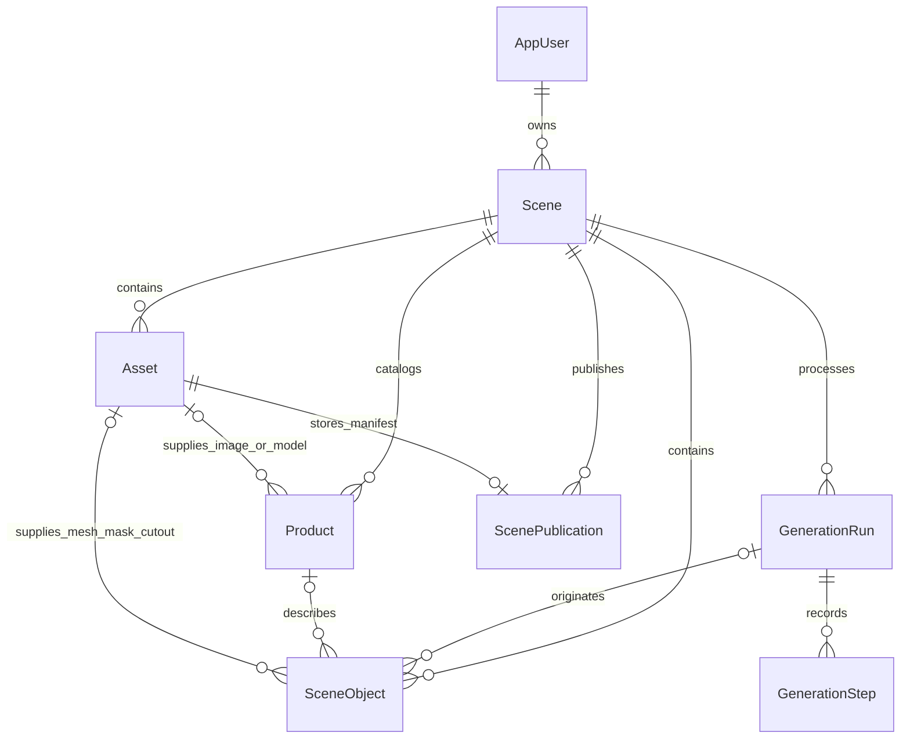

# ReScene data model and contracts

The [Prisma schema](../prisma/schema.prisma) has eight models, nine enums, and explicit foreign keys/indexes. The initial [migration](../prisma/migrations/20261029040000_init/migration.sql), including [additional SQL constraints](../prisma/constraints.sql), was applied October 29. This document also specifies behavior for later reconstruction/publication phases; see [SETUP.md](SETUP.md) for current implementation limits.

## 1. Entity relationships



`Scene` is both the editing workspace and unit of ownership; there is no extra Project/Workspace hierarchy. A small per-scene product catalog supports replacement without global catalog permissions/synchronization. A future multi-scene catalog can be added after the demo.

## 2. Table responsibilities

| Model | Important fields | Why it exists |
| --- | --- | --- |
| AppUser | UUID id, unique opaque authSubject, displayName, timestamps | Maps managed identity to the application; no auth internals |
| Scene | ownerId, status, revision, source/normalized/poster asset IDs, camera/stage/settings JSON, archivedAt | Single ownership root and draft concurrency boundary |
| Asset | sceneId, kind/status, bucket/key, SHA-256, bytes, dimensions, derivation, provenance, upload expiry | Immutable binary references and validated storage lifecycle |
| Product | sceneId, merchant fields, Decimal price/currency, HTTPS URL, image/model asset IDs, attributes | Actual commercial information separate from inferred objects |
| SceneObject | sceneId/sourceOrdinal, label/category/status, mask/cutout/model/product IDs, transform, bounds, visibility | Stable semantic object used by segmentation, rendering, editing, and shopping |
| GenerationRun | sceneId/kind/status, idempotency key, workflow ID, inputRevision/input, deadline/progress/cost | Durable user operation with frozen input and recovery state |
| GenerationStep | runId/key/attempt, model/provider/request ID, input/output, response asset, usage/error | Traceable stage attempts, artifact reuse, retry safety |
| ScenePublication | sceneId/revision, random slug, immutable manifest asset ID, asset allowlist, revoke time | Frozen anonymous share independent of future draft edits |

All database entity IDs are UUIDs. Auth subjects remain opaque strings; do not assume an external auth ID is a UUID. Publication slugs are independent random capability identifiers. Use database timestamps in UTC and display them in the user's timezone.

## 3. Ownership and identity

Neon Managed Better Auth owns its `neon_auth` tables. Use the [managed Next.js integration](https://neon.com/docs/auth/quick-start/nextjs-api-only) and retrieve the current session in private server operations. On first authenticated application access, idempotently upsert AppUser by authSubject.

Scene.ownerId points to AppUser. Assets, objects, products, runs, and publications inherit ownership through sceneId. A foreign key to an Asset/Product alone **does not ensure it belongs to the same scene**. All attaching/signing/ingesting services must check scene membership inside the operation's transaction and have a cross-user test. The proposed schema deliberately does not claim database-enforced tenant isolation or RLS.

No browser database client or public SQL endpoint is used. Private DTOs omit auth subjects, storage credentials, and unrestricted provider artifacts. Public DTOs have an even smaller explicit field list.

## 4. Scene and object state

Scene state:

```text
DRAFT → ANALYZING → REVIEW → RECONSTRUCTING → READY
             ↘ FAILED          ↘ READY with failed objects / FAILED
any active state → ARCHIVED
```

FAILED is recoverable through the relevant run/review action. A failed optional image enhancement must not destroy an otherwise READY scene. REVIEW may have more candidates than the five-object render limit; only confirmed/non-excluded objects enter the viewer contract.

Object status is separate from render representation. DETECTED/CONFIRMED/RECONSTRUCTING/READY/FAILED/EXCLUDED describe processing. MESH/CUTOUT/PROXY describe what the viewer can render. A failed 3D job can retain a valid mask/cutout with an explicit fallback label. Visibility is a reversible editor choice; exclusion removes a candidate from reconstruction.

`sourceOrdinal` is stable within the immutable source photo, not a provider index. The `(sceneId, sourceOrdinal)` unique key supports idempotent candidate updates. Provider IDs are scoped to their request and stored in provenance. Replacing the source image creates a new Scene in the MVP, preserving existing object identity and publications.

### Coordinate contract

- Right-handed, Y up; floor at Y=0. Initial camera looks toward the stage center.
- Position is `[x,y,z]`; rotation is quaternion `[x,y,z,w]`; scale is positive `[x,y,z]`.
- Geometry is object-local and its root applies the transform exactly once.
- Use a bottom-center local pivot; world Y stores the reviewed support height. This makes floor/tabletop placement and replacement alignment predictable.
- Default units are approximate. Calibrated scenes explicitly record meters after applying one consistent conversion to objects, stage, and camera.
- `localBounds` is local bounding **size** `[width,height,depth]`, not world coordinates or min/max corners.
- `initialTransform` stores the imported baseline for “Reset layout.” It does not undo later catalog swaps or restore deleted publications.
- The editor changes scale uniformly; imported base scales may be nonuniform. Apply a uniform multiplier to that base, rather than forcing all imported scale components equal.

Private image bounds use `{xMin,yMin,xMax,yMax,imageWidth,imageHeight}` with top-left origin and exclusive max bounds. Values refer to Scene.normalizedAsset's actual dimensions. Boxes and masks never mix original-photo pixel space with resized-photo pixel space.

## 5. JSON field contracts

| Field | Validated shape/contents |
| --- | --- |
| Scene.camera | The manifest camera definition; initialized before a scene can render/publish |
| Scene.stage | The manifest simple-room stage definition |
| Scene.settings | Versioned private config: units, optional calibration anchor/conversion, confirmed object IDs, prompt/importer versions |
| SceneObject.imageBounds | Pixel rectangle plus normalized image dimensions |
| SceneObject.localBounds | Three positive local dimensions; nullable before an asset exists |
| SceneObject.initialTransform | Position/quaternion/scale from normalized import |
| SceneObject.provenance | Candidate/request identity, geometry source, reconstruction run/importer version; no credentials |
| Asset.provenance | Provider/model, source run/step, optional seed, source/rights/license URL, importer version |
| Asset.metadata | Kind-specific facts: image orientation/dimensions or mesh triangle/texture/bounds validation stats |
| Product.attributes | Up to 12 merchant-authored string fields with bounded values |
| GenerationRun.input | Immutable source/normalized asset IDs, ordered `{objectId,maskAssetId}` entries, operation/config versions, target object for individual jobs |
| GenerationStep.input/output | Stable IDs and small stage results; no large base64, mesh bytes, or credentials |
| ScenePublication.assetIds | Frozen unique array of allowed render asset UUIDs; derived from the manifest |

The schema uses `{}` defaults for not-yet-initialized private JSON. Do not pass these directly to the viewer. Construct a renderable manifest only after required fields are initialized and validated.

## 6. Asset types and lifecycle

| Kind | Format | Can a public viewer receive it? |
| --- | --- | --- |
| UPLOAD_STAGING | Untrusted uploaded bytes | No |
| SOURCE_IMAGE | Accepted immutable original | No |
| NORMALIZED_IMAGE | EXIF-stripped resized image | No |
| MASK | Full-size binary PNG | No |
| CUTOUT | RGBA PNG/WebP | Only for an explicitly published cutout representation |
| MODEL_GLB | Self-contained validated GLB | Yes, if referenced by the snapshot |
| PRODUCT_IMAGE | Validated merchant thumbnail | Yes, if referenced |
| POSTER | Rendered scene preview | Yes, if referenced; never substitute the source photo silently |
| PROVIDER_RESPONSE | Private JSON/text artifact | No |
| SCENE_MANIFEST | Immutable canonical JSON | Parsed by the app; only the safe contract is returned |

Asset status is PENDING→VALIDATING→READY or REJECTED; transient validation failure returns to PENDING. An atomic VALIDATING claim prevents competing upload completions. Deletion goes DELETING→DELETED. READY means bucket/key, checksum, bytes, validation, and readyAt are recorded. Temporary URLs are derived, never stored as permanent references.

Record one parent derivation when useful (e.g. cutout from normalized photo). Multi-input provenance such as an image plus several masks stays in the run input. Ready files are never overwritten. A replacement creates a new asset ID and updates a draft reference; old publication references remain valid.

Archive scenes rather than cascade-delete them through the UI. R2 deletion is not performed by database foreign keys. Cleanup enumerates all scene assets, waits for active jobs and signed URL expiry, removes bytes, then marks rows deleted. Hard database deletion is an explicit future maintenance operation.

## 7. Products and replacement

`Product.price` is a nonnegative `Decimal(12,2)`; return a string such as `"49.00"` to avoid binary floating-point errors. Currency is a three-letter uppercase code and must be present when price is present. This MVP uses two decimal places and is not a multi-currency checkout ledger.

URLs allow HTTPS only after standard URL parsing. Never fetch a product URL to scrape details in the MVP. Product content is text, not trusted HTML. Do not let arbitrary attributes introduce scripts or unrestricted public metadata.

A SceneObject's modelAssetId controls current geometry; productId controls its commercial card. A Product can have a prepared replacement GLB and image. Replacement checks same-scene ownership and validated asset type, then atomically swaps both references and increments Scene.revision. Normalize the replacement pivot and fit it to the selected object's reviewed bounding size while allowing manual correction. Keep original analysis identity separate from the current geometry source.

## 8. Transactions, concurrency, and cost

Use optimistic concurrency on every draft mutation. In one transaction, update Scene where `{id,ownerId,revision:expectedRevision}`; require exactly one matched row; increment revision and apply all related updates. A later failure rolls everything back. Bulk object edits verify every ID belongs to that scene before writing.

Before starting or restarting a job, hold a short advisory transaction lock; check active jobs, ownership and current scene revision, then create the run or clear later results. The supplied SQL adds one-active-run-per-scene uniqueness. One-active-run-per-user spans tables and needs the transactional service gate. Jim removed the cumulative app budget gate on October 29; reservedCostUsd is retained as an estimate, not an enforced allowance.

Cost reservation is conservative accounting, not a guarantee that a provider cannot bill more. Set the host account's spending limit where supported, measure actual rates, count uncertain submissions conservatively, and default GENERATION_ENABLED off until configured. Null cost means unknown, not free.

No open database transaction spans a model request, storage upload, or GPU wait. Persist stage facts and perform each external operation outside short transactions. Workflow retries use stable IDs and compare-and-swap state to reuse completed work. Store a separate GenerationStep per attempt; do not overwrite failure history.

## 9. Publication contract

The [JSON Schema](../contracts/scene-manifest.schema.json) is the versioned canonical render contract; the [example](../contracts/examples/scene-manifest.json) is synthetic. Schema validation enforces field names/types/bounds and representation-specific asset references. Service validation additionally requires:

1. Unique object and product IDs; referenced products must be included, with no unrelated catalog entries.
2. Every render asset is READY, same-scene, correct kind, and free of external GLB resources.
3. The allowlist equals the reachable mesh/cutout/product-image/poster IDs. Raw source/mask/provider-response assets are never reachable.
4. Quaternion norm is within tolerance; scale/positions/bounds are finite; camera min/max distances are ordered and camera is not at its target.
5. Scene revision matches the intended snapshot and scene is not archived; objects are reviewed and renderable. Warn clearly about any non-mesh representation.
6. Price/currency pairing and HTTPS URLs pass semantic validation; public strings render as escaped text.

Publication writes a validated JSON asset, then commits its row/allowlist only if revision is unchanged. Frozen product values and asset IDs mean future edits do not alter the published scene. The public endpoint does not rejoin live Product rows for prices.

Slugs are 24 random bytes / 32 base64url characters. Store them only on the publication record, avoid logs/referrers, and return them only to its owner or a visitor already presenting the slug. This is deliberately an unlisted public sharing capability, not password-protected sharing.

## 10. Migration and initialization order

1. Provision/link the selected development Neon project and enable Managed Better Auth separately.
2. Scaffold compatible pinned Prisma 7 CLI/client/Neon adapter packages and `prisma.config.ts`.
3. Generate the first migration locally/development-only. Append reviewed [constraints.sql](../prisma/constraints.sql); inspect that no managed auth tables are changed.
4. Apply to a disposable/development database and verify constraints/foreign keys. Generate the Prisma client.
5. Implement session→AppUser upsert, then create Scene, then upload Asset. Set Scene.sourceAssetId after the asset exists (the nullable pointer breaks the creation cycle).
6. Implement jobs, masks/objects, products, and publications in that order. Use trusted seed scripts to create a few per-scene replacement products/GLBs; no public arbitrary GLB upload endpoint.
7. Deploy reviewed migrations with `prisma migrate deploy` to the selected environment before the matching app release. Do not run `migrate dev` in production or all preview builds.

## 11. Focused verification

Validate Prisma and the manifest schema offline now. During implementation, exercise duplicate idempotency keys, simultaneous saves, active-run uniqueness, cross-scene references, invalid transforms, and immutable publication reads against an isolated database. Use real mask/GLB fixtures for the importer because the largest failures are semantic, not type errors.

Keep live-provider smoke tests explicit and small; normal CI uses sanitized fixtures and never consumes inference credits. Report schema validation separately from database/application/inference validation.


### Current private composition JSON (October 29)

- `Scene.stage`: `sam3d-room-v1` validated object with camera `{position,target,fov,aspect}`, room `{centerX,centerZ,width,depth,height}`, environment `{floorColor,wallColor,floorMaterial,lightDirection,lightWarmth,sideWall}`, environment source, projection error, and approximation warnings.
- `Scene.camera`: duplicate current photo camera for the future manifest adapter. Orbiting is transient; Photo view returns to this camera.
- `Scene.settings.environment`: validated Spark observations from `room-and-objects-v2`; absent in older scenes. `layoutBackup` contains one previous camera/stage and object baseline/draft transforms for owner-triggered restore, never binary data or signed URLs.
- `SceneObject.initialTransform`: `sam3d-layout-v1` with `rotation` XYZW quaternion, positive `scale`, `offset`, and rotated/scaled bound `size`, all numeric arrays. This is the imported mesh baseline. Draft position, quaternion yaw, and uniform scale fields operate on the baseline's bottom-center pivot. A future publication adapter must flatten both transforms.
- Existing manual-stage baseline objects remain readable. Owner-triggered Match photo layout upgrades them using saved provider metadata; no hidden database migration or GET mutation occurs.
- Object provenance retains support classification across segmentation and ingestion. Old floor-furniture categories supply a documented fallback when earlier code omitted it.


### Step-restart state (October 29)

Scene.settings.resetRevision identifies the current workflow epoch without changing the SQL schema. Workspace filters earlier runs; failed earlier runs become CANCELED and cannot resume. Earlier successful run/step usage remains historical. Cleared asset rows become DELETED; new signing rejects them. SOURCE/NORMALIZED pointers survive ANALYSIS/RECONSTRUCTION restart; mask/object IDs survive only RECONSTRUCTION. All targets clear room/camera/baseline edits and layout backups, clear product associations, and revoke later publications. R2 bytes are retained privately until a separately authorized cleanup; lifecycle rules stay unchanged.


### Appearance data (October 29)

`AssetKind.SURFACE_TEXTURE` is added by migration 20261029110000_surface_texture for private PNG floor/wall patches. Baked models remain embedded-texture MODEL_GLB assets with derivedFromId pointing to the original mesh and provenance describing the photo/bake version. Settings.appearance stores photo-bake-v1, per-object originalId/bakedId/copied texel counts, and floorId/wallId. Settings.lighting stores bounded key/fill XYZ/intensity and ambient fill. Workspace signs only same-scene READY surface assets. Restore keeps original immutable assets and swaps references under revision/ownership checks. No source photographs are embedded in baked GLBs; public serialization must allowlist only approved derived assets.

### Phase 4A implemented behavior

PATCH objects optionally includes merchant product fields or null (unlink); omission preserves the existing association for older clients. Product/asset IDs are server-owned. Product creates/updates share the transform/light transaction and expectedRevision CAS. PRODUCT_IMAGE cutouts are immutable, privately stored, and derived from the reviewed mask with source-photo/object provenance. A cutout upload can outlive a conflicting save; no automatic byte cleanup is enabled. Unlinked Product rows remain private for future snapshot/history support. Publication must freeze fields rather than joining live Product records.

### Phase 4B implemented behavior

Catalog Product.attributes.catalogVersion=demo-v1 marks trusted original demo templates; model/image assets carry catalogKey, generator and CC0 provenance. Placed copies use demoSourceId instead and are independent merchant rows. Object.provenance.replacementBackup stores the original modelAssetId/productId/label/initialTransform/localBounds once. Replace/restore are atomic scene-revision transactions and validate same-scene READY mesh/image references. Restore removes this backup, preserving current transform columns. Scene restarts already clear provenance/products/catalog model/image assets. Snapshot serialization must exclude backup/provenance/template rows and expose only current approved render assets and merchant fields.

### Phase 5 implemented v2 publication

contracts/scene-manifest-v2.schema.json and src/lib/scene/manifest.ts are the implemented contract; v1 remains historical proposed design. Serialize visible READY meshes and only referenced products. Flatten T(draft)×R(draft)×S(draft)×T(import offset)×R(import baseline)×S(import baseline) into canonical right-handed/Y-up world position/quaternion/scale. Manual-stage meshes get their original renderer bottom-center normalization first. The public renderer uses these world transforms without normalizing them again.

ScenePublication points to immutable SCENE_MANIFEST bytes with SHA-256 and a deduplicated exact list of reachable MODEL_GLB / PRODUCT_IMAGE / SURFACE_TEXTURE IDs. The manifest itself is never signed to anonymous callers. Read-only DTOs contain approved model/image URLs and frozen values, with no draft/raw/provenance data. Repeated/concurrent publish of one saved revision returns the active existing link, serialized on the Scene row. Publication does not change draft revision; mutations that win during storage preparation make publication CAS fail. All active links are returned to the owner (maximum ten); revoked records are retained as history. Archived scenes and revoked records cannot issue new viewer access. Existing cached bytes/signatures cannot be recalled.

## Release project management

Owner-only manage actions archive/restore under expectedRevision and the same advisory lock as generation starts. Archive preserves assets/products/stage/camera, records the previous status in settings.archive, sets archivedAt/status and revokes every active share. Restore recovers the saved status, clears archival bookkeeping and keeps old links revoked. Archived objects are excluded from active APIs/signing; only their owner can list private archived previews or restore them. Metadata edits also serialize with generation starts and increment revision; earlier snapshots keep frozen titles/descriptions.

## General scene correction

No migration: SEGMENT_OBJECT already exists in RunKind. GenerationRun.input stores analysis/segmentation/reconstruction controls, exact normalized asset identity and a hash used with the idempotency key. A single-object attempt stores its resolved object ID; no new Spark call is needed. SceneObject.provenance.maskAlternatives stores bounded same-scene MASK IDs, confidence, image bounds and foreground area. Workspace signs only READY masks; selecting/combining validates this exact object-specific list and commits through the scene revision boundary. Combined masks are new immutable binary unions, not in-place edits. Old provider attempts and assets remain private.

Analysis options/summary/type/preferred backdrop live in Scene.settings; reconstruction restarts preserve them and mask alternatives. The optional Scene.stage.backdrop is room/studio/none. Publication v2 freezes it with the rest of composition; omitted legacy values render as room. New category labels remain strings in SQL. General input support does not add user-supplied asset URLs or widen publication allowlists.

## Complete-subject correction (supersedes product-only extraction)

See [SCENE_UNDERSTANDING.md](SCENE_UNDERSTANDING.md). scene-assemblies-v4 discovers roots and product parts automatically; parentObjectId/assemblyRootId, shared original mesh ID and partition version live in existing private provenance JSON. GenerationRun.input freezes selected entries and the root IDs actually submitted to fal. No SQL migration is required. Root reconstructions are partitioned into disjoint selectable triangle regions, retaining source UV/materials and a shared pose; failed partitions keep the complete root. Group edits, matching, catalog guards and complete-assembly publication honor those relationships.

The direct SAM decoder now scales a raster into its source-coordinate box. Automatic shoe union and region disambiguation reuse returned masks. The floor is a conservative lower geometry envelope, with optional floorY in composition/publication v2. Ten render entries are supported; this is an internal resource bound, not a user item-count question. Whole human appearance was tested using the existing SAM 3D Objects provider. SAM 3D Body and Align were researched but not integrated; anatomy/fit and unseen detail remain approximate.

## General scene quality correction — October 30

See [SCENE_QUALITY.md](SCENE_QUALITY.md). scene-relations-v5 adds broad categories and validated supportedByCandidateId, separate from attached parentCandidateId. Relationships persist as private supportedByObjectId; no migration. Contact settling uses support-top/shared-plane estimates and actual vertex-bottom refinement. Shared part geometry retains its root baseline.

Photo transfer supports up to ten meshes, original-root camera calculation, bounded silhouette registration and up-to-2K source-pixel bakes. Existing photo-bake-v1 restore data is retained, with method=registered-2k-v2; refreshed bakes derive from immutable originals. Optional CPU-only post-ingest transfer runs once and cannot trigger inference resubmission. Public asset boundaries remain unchanged. Body and Align were tested as private experiments; returned GLBs lack UVs/textures, so they are not automatically used to replace textured subjects or solve arbitrary object contact.
