# Budget-aware shopping stylist — proposed implementation

November 1, 2026, Asia/Manila. **Planning only; not implemented.** Jim clarified that “for demo” means prioritize the essential end-to-end experience, not restrict it to the eleven products on the existing demo pages. This plan replaces the larger standalone-library proposal considered during investigation.

## 1. The outcome and the boundary

A shopper opens an interactive showroom built from successful ReScene reconstructions, selects a piece and asks: “Keep this chair. Make this corner warmer, and keep the merchandise subtotal under $500.” Typed input and the existing Muse Voice Transcribe input lead to the same request. Spark proposes two coordinated combinations; code checks their prices and placements; the shopper previews either, applies one, undoes it in one step, or adds the intended products to the existing demo bag.

**Put the shopper interaction in Build your space first**, sharing the implementation with Shop the scene. The reconstruction editor supplies the products and their details. Do not put shopping decisions into analysis/mask/mesh generation: creating assets is merchant authoring; selecting affordable combinations is shopper activity. A shopping request must not submit new mesh or image generation.

The first delivery has three connected parts:

1. Save reusable product details against generated meshes, using the existing database and storage.
2. Build a small approved shopping assortment from those records, including successful generated products beyond the current eleven where appropriate.
3. Add the budget stylist and reliable Apply/Undo/bag behavior to the showroom.

Defer a separate library dashboard, inventory/stock management, merchant integrations, real checkout, currency conversion, vector search, autonomous regeneration and a comprehensive asset-versioning redesign. Keep support for arbitrary product categories; furniture is the demonstration, not a detection restriction.

## 2. What the audit actually found

Read-only checks against shared Neon on November 1 found:

- 69 scenes: 49 active and 20 archived.
- 270 READY `MODEL_GLB` Asset rows, all with checksum/size metadata, plus 22 logically DELETED model records. These are artifacts and versions, **not 270 unique products**. Of the ready artifacts, 121 identify `meta-generation`, 95 `photo-bake-v1`, 28 `coordinated-quality-v1`, four assembly derivatives, one material-relief derivative and 21 have no `provenance.source` value.
- 121 ready SceneObjects with meshes across all scenes; 116 in active scenes. Only three active objects have linked Product records, and only two of those products have prices.
- 46 Product records overall, all described and pictured; 15 have price/currency. Many are per-scene catalog/template or detached records, so this count does not describe shopper-ready generated objects.
- The public shopping catalog is eleven authored fictional listings in `src/lib/demo/catalog.ts`. Its approved GLBs are separate frozen R2 copies. No Asset rows currently register the `demo/store-v1/` copies.
- Six bounded R2 HEAD checks succeeded: three current private models and three approved demo models. The three private sizes matched Neon. This was a spot check, not a full bucket/checksum audit.

**The files are already saved.** The principal gap is product identity/details/price linkage and a controlled path from a private generated object to an approved shopping item. Do not regenerate meshes, bulk-copy the bucket or pretend every model version is a separate SKU.

Source review mapped application routes and the source tree, then traced generation, selective retry, appearance/quality updates, assemblies, product saving, replacement, creative-image lineage, restart/Trash, publication, frozen demo export, arrangement validation/history, voice and bag flows. Current code and Prisma take precedence over historical planning statements in older docs.

## 3. Reuse the existing Product and Asset records

Keep `Asset.sceneId` and all current same-scene ownership checks. Keep the existing `Product` model as the initial reusable catalog record: an owner-wide query can find catalog products through `Product.scene.ownerId`. A new global asset hierarchy is unnecessary for this delivery.

Proposed additive Product fields, with exact naming finalized during implementation:

- `catalogRole`: nullable enum `SOURCE | INSTANCE | TEMPLATE`. SOURCE is a reusable listing; INSTANCE is a scene-local copy of a listing; TEMPLATE identifies existing procedural seed products. Existing rows are not automatically approved.
- `catalogStatus`: `DRAFT | READY | ARCHIVED`, default DRAFT. READY requires complete shopping data and usable independent geometry.
- `catalogKey`: optional unique public/demo alias, preserving current IDs such as `corner-chair`. Public aliases do not expose source scene/object IDs.
- `sourceProductId`: optional self-relation for imported/replacement instances. The instance keeps its own listing snapshot, so scene-local edits do not silently change the source listing.
- `inferredDetails`: bounded, versioned JSON for AI observations/drafts, style tags, palette, role, source association and field provenance. Keep it distinct from the existing merchant-only `attributes` contract. Reuse existing name, description, brand, SKU, Decimal price/currency, imageAssetId and modelAssetId.
- Index the catalog eligibility fields and sceneId; retain source/instance foreign keys. Treat referenced catalog products/assets as retained records, not cascading cleanup candidates.

No new product/variant/media management suite is needed. The initial finish list can be validated JSON associated with the catalog record and exported snapshot. Give finishes stable keys, retain legacy color-index mappings, and distinguish an illustrative tint from a merchant-approved purchasable finish. Preserve existing authored dimensions/materials as sample data; never treat them as measurements recovered from the mesh.

### Creating and updating a generated listing

- When a usable merchandise object first receives a mesh, create or attach its SOURCE Product in the same guarded persistence path. Set modelAssetId, a useful name/category and a nonempty descriptive draft; derive a thumbnail with the existing product-thumbnail helper. Use existing analysis evidence first.
- Unknown price stays null with a clear “Price needed” state. It must never be treated as zero. A short “Prepare demo listing” action can fill explicitly fictional description/material/size/finish/price defaults for review. Actual merchant-entered values always take precedence.
- Reuse the editor's product form for the essentials: name, short description, price/currency, material/style, thumbnail and Ready for showroom. Add an explicit sample-data label when using fictional details. Do not make a new admin dashboard a dependency.
- On accepted reconstruction, texture or quality changes, update the canonical model pointer only if it still refers to the version being replaced. Register rejected candidates as existing historical Assets; do not make them the selected catalog model.
- Keep all generated mesh artifacts in Asset/run history. Only selected, usable versions are recommendations. Whole people, background surfaces and shared-atlas body/garment parts are not automatically independent purchasable objects. Those can remain private asset records/draft listings until an appropriate approved representation exists.
- Listing preparation must not turn a successful reconstruction into a failed run. If thumbnail/metadata work fails, retain the mesh and a recoverable DRAFT listing. No automatic paid metadata/image retry.

### Lifecycle changes that are necessary

`services/restart.ts` currently deletes every scene Product and logically deletes earlier model/image Assets. Change it to retain SOURCE catalog records and the specific GLBs/thumbnails they reference. Continue clearing the restarted scene's object links and later authoring steps. Protect retained source listings from the ordinary transient-product cleanup; do not keep every unrelated intermediate asset READY just to satisfy the library.

Existing project deletion is recoverable Trash. Products from a trashed source project should disappear from **new private catalog selection** until restored; their rows/files remain saved. Already approved public demo copies remain deliberately separate. An imported target-scene instance uses its own asset/listing snapshot, so subsequent source edits/restarts cannot rewrite it. Physical deletion of a referenced catalog asset must be blocked; automatic R2 cleanup remains disabled.

This is a source-scoped catalog with retention, not a claim that we have built a fully independent enterprise asset library. That larger separation can be introduced later if projects need permanent physical deletion.

## 4. Backfill and curate without another reconstruction run

One idempotent preparation command should support dry-run and apply modes:

1. Inventory current ready objects and their selected valid models, existing Products, thumbnails and source/assembly relationships for the authorized owner. Exclude the protected fixture from any mutation. Skip archived sources and the 22 logically deleted model records; do not resurrect deleted content from R2.
2. Reuse existing merchant records. Create missing SOURCE draft listings for active merchandise candidates, with names/descriptive drafts and model links. Deduplicate by source object/listing association, not by label or by assuming visually similar products are the same SKU. Multiple versions of one object remain versions, not new merchandise.
3. Import the eleven existing fictional demo listings into corresponding catalog records, preserving aliases, finishes, descriptions and prices. Register their already approved frozen R2 files in Asset rows under the appropriate source ownership; retain the public delivery allowlist. Do not alter the user's current SceneObject transforms or replace its current selected model with an older frozen demo copy.
4. Review a small compelling assortment for the walkthrough: start with the current approved products, then add a few suitable successful generated meshes with complete **sample** details/prices. Do not block the demo on completing every draft in the database. Do not submit new inference merely to repopulate existing products.
5. Extend the existing export/curation script to read READY catalog records and emit the public listing snapshot plus the existing frozen render manifest. For newly approved items, create only the necessary sanitized demo derivative. Keep source photos/masks/prompts/provider replies private.

R2 contains bytes; Neon records their identities, selected versions and product details; the approved release connects public product aliases to exact model digests. Check existence, size/type and GLB validity at preparation/promotion time, with checksums when ingesting/copying. Failed copies cannot create a READY public item. Leave missing files flagged for recovery rather than substituting a different mesh.

**Single publishing direction:** database catalog → reviewed public demo snapshot. `demo/catalog.ts` becomes an adapter for that snapshot. Avoid maintaining unrelated handwritten and database catalogs. Preserve the eleven old public IDs and existing bags/layouts. Catalog changes require a refreshed approved snapshot; stylist Apply checks the quoted catalog version and rejects stale data.

## 5. A compact shopper workflow

Add **Stylist** to the existing right inspector alongside Products, Room and Layouts. Keep the canvas, photo comparison, manual controls and pinned bag action. Use the same panel component in Build and Shop; no separate full-screen chatbot.

The panel contains:

- A short instruction field and existing Speak control. Dictation inserts editable text; it does not immediately change the scene.
- A visible budget field, USD for this delivery, and concise “Merchandise only; tax and shipping excluded” text.
- A selected-item “Keep this product” control and small kept-item chips. Keep product/finish separately from the existing position lock. Add “Already own this” only as an explicit purchase-scope control, not an inferred consequence of “keep.”
- A single “Suggest two looks” action. Show real processing stages, then two compact cards with small product thumbnails, exact subtotal, amount under budget, one sentence of explanation and Preview/Apply.
- Expandable line-item details rather than a large permanent transcript or another wide toolbar. Keep the primary flow usable in the desktop showroom without pushing the bag below the scene.

Preview A/B changes only a transient preview draft. Switching/canceling a preview does not pollute Undo or overwrite a saved arrangement. Preload the replacement assets; if a model fails to load, return to the accepted scene and explain it. Never show a new listing over the previous product's mesh.

Applying an option makes **one history entry** containing products, finishes, poses, room/light changes and purchase scope. Undo restores the entire prior combination; Redo restores the chosen one. Adding to the bag remains explicit and separate. Undoing the scene does not remove an independently added bag item.

## 6. Agent workflow: interpretation, feasible choices, explanation

Use Spark 1.3 through the existing Meta client and strict structured-output helper. Two small bounded model stages are justified: understanding the request and choosing/explaining from feasible results. No free-running tool loop or new model provider is needed.

```mermaid
flowchart LR
  Input[Typed text or reviewed Muse transcript] --> Intent[Spark: intent and style]
  Intent --> Search[Code: approved catalog and valid combinations]
  Search --> Rank[Spark: select and explain two candidate IDs]
  Rank --> Check[Code: recheck price, locks and final placement]
  Check --> Preview[Preview A or B]
  Preview --> Apply[Explicit Apply: one Undo entry]
  Apply --> Bag[Explicit add to demo bag]
```

1. Validate the current collection, draft, budget, selected item, kept items, purchase scope and catalog release. Server loads prices, finishes and models; client-supplied prices are ignored. If locked purchases already exceed the budget, explain that before inference.
2. Spark produces a bounded intent: desired style/palette, preserved items, required roles and optional layout/lighting/background preferences. Resolve “this chair” against selection. Return a clarification when the target or budget is genuinely ambiguous. Explicit budget/keep controls cannot be weakened by model output; additional keeps inferred from text are shown in the interpreted request.
3. Code searches approved role-compatible products and finishes, retaining required roles/counts and purchase scope. For the small initial assortment, enumerate product choices with budget pruning and the existing curated layout candidates. Rank/cap candidates before sending them back to Spark; do not send the entire asset history. If a larger search is bounded, say no match was found within those candidates rather than claiming a mathematical impossibility.
4. Compute prices and validate each complete candidate arrangement in code. Spark receives only feasible candidate IDs and factual product metadata, then selects two distinct combinations and gives short reasons. It cannot invent a product, price, discount, finish, dimension or merchant URL.
5. Recheck the selected IDs and their final arrangements before returning them. If only one valid option exists, show one with the reason; if none exist, explain the constraint and the smallest supported relaxation. Do not fabricate a second option or silently exceed the budget.
6. Apply revalidates the base-draft hash, catalog version, item eligibility, price and locks. If the shopper edited the scene, the quote is stale. Recheck client state after the response before committing to history. Changing a budget requires a new reviewed proposal; retrieving a saved proposal does not rerun inference.

The first release works with the showroom's prepared slots and support relationships, not arbitrary generated object counts or on-demand room construction. Newly curated products can replace compatible slots. A request for an unavailable lamp must explain that it is unavailable; it must not invent a lamp or submit a reconstruction in the background.

## 7. Budget and placement rules that must be enforced

- Use integer minor units for all calculations, converting the existing Decimal prices exactly. Currency is USD initially; preserve other saved currencies but exclude them from mixed-currency recommendations. Display cents correctly—the existing `money()` rounds to whole dollars and must be corrected for quotes.
- By default, every product in the proposed purchase combination counts, including a kept chair. “Already own” explicitly excludes it from the **new-purchase subtotal** and bag. Still show the item in the scene. Make this distinction visible before generating options.
- Count quantities/instances. Two identical chairs cost twice the unit price. Missing price is ineligible, never free. Only explicitly approved zero-price listings may be zero.
- Required products cannot be hidden or removed to cheat the budget. Merely hiding an item is a view action and does not silently change purchase inclusion. Shop currently stores inclusion separately from visibility; unify the quote/bag purchase scope deliberately.
- “Keep” preserves product identity, finish and inclusion/visibility. Position lock preserves pose; unmentioned position locks remain active. Parent movement must not move a position-locked child indirectly.
- Match semantic roles: a chair remains seating, a storage requirement remains storage, and an accessory remains on an appropriate support. The current general floor replacement guard is too permissive to be a stylist's compatibility policy.
- Validate the **whole final arrangement**, not only a sequence of edits. Sequential replacements can fail on temporary collisions even when their final combined placement is valid. Reuse footprint/support math, with one joint validator used by manual edits, voice and stylist application.
- Check upright orientation, support contact/containment, collisions and observed room boundaries where available. Preserve the accepted source camera/geometry. Do not promise exact real-world fit from sample dimensions or approximate single-photo scale.
- Current demo collision checks allow some inherited overlaps. New candidates must not introduce or worsen overlap; report inherited unresolved collisions instead of claiming a clean room. A photographed wall is not always a reliable complete room boundary.
- “Warmer” can coordinate product finishes plus existing room/light presets. Those controls have no merchandise charge in the demo; label them as scene styling rather than purchasable products.

For an illustrative price check using current listings: Haven chair $249 + Arc side table $89 + Terra vase $49 = **$387**. Haven $249 + Gather table $149 + Still vase $39 = **$437**. These demonstrate budget arithmetic; they become actual recommendations only after role, finish and joint-placement checks pass. Keeping both the $249 chair and $329 cabinet already totals $578, so a $500 purchase budget cannot be satisfied without an explicit constraint change.

## 8. Minimal backend additions

Add one durable `ShoppingStylistRequest` model rather than a conversation framework:

- UUID; optional authenticated ownerId; signed guest actorHash; idempotency key/input hash; collection/release key; base draft hash; submitted text and optional owned VoiceAttempt link; budget minor units/currency; bounded request-context JSON.
- Status/phase; validated intent; compact candidate/option snapshots and computed subtotals; planner/ranker submission states; usage/error code; expiry and timestamps.
- Unique `(actorHash, idempotencyKey)` and indexes for actor/time/expiry. Reserve each paid stage before submitting; recover completed results. An interrupted/uncertain stage is not automatically paid again. Store concise explanations, not chain-of-thought.

Proposed routes/services:

- Owned catalog preparation and detail saving use the existing scene product API/service paths, with explicit owner checks and revision CAS.
- A catalog/export command produces the approved release; no new anonymous endpoint can query all private generated products.
- `POST /api/shopping-stylist` reserves a request and starts the bounded existing-workflow orchestration; `GET /api/shopping-stylist/[id]` retrieves only that actor's saved result; `POST /api/shopping-stylist/[id]/apply` revalidates the chosen canonical option. Apply returns scene state; it does not mutate the merchant's source scene or make a purchase.
- Reuse origin checks, bounded JSON, Zod, Meta adapters, existing Workflow infrastructure and guest/auth rate-limit patterns. Disable SDK/workflow automatic paid retries for both Spark stages. Retain existing operational limits without reinstating the removed cumulative dollar cap.

The existing guest voice cookie is scoped to `/api/voice`; it will not automatically identify a request at `/api/shopping-stylist`. Extract a shared signed guest identity with an appropriate API cookie path and preserve outstanding voice recovery during its short lifetime. Verify any supplied VoiceAttempt belongs to that actor. Typed requests must not require or fake a transcription receipt.

The existing bag is a local demo bag. Keep that behavior and fictional checkout. Reuse its merging and review UI, but resolve the approved product/finish and canonical quoted prices. Check existing quantities before adding; do not silently cap a combination to twenty units or drop lines. Show that the budget applies to this combination, not unrelated items already in the bag. Repeated clicks must not accidentally add the same pending operation twice.

## 9. Source map and targeted changes

- `prisma/schema.prisma`: additive catalog fields/self-link and the request receipt. No rename/drop of existing tables or data.
- `services/generation.ts`, `reconstruction-repair.ts`, `appearance.ts`, `quality.ts`, `contained-assemblies.ts`: register/update the selected source listing from successful owned artifacts, using one shared helper; preserve quality/history behavior.
- `services/product-thumbnail.ts`, `validation/products.ts`: reuse thumbnail generation and price validation; add bounded catalog-detail validation with provenance.
- `services/restart.ts`, `project-management.ts`, `catalog.ts`: retain reusable listings/assets; distinguish instances/templates; import a chosen library product into the target scene rather than bypass same-scene guards.
- `scripts/export-demo-store.ts`, `demo/catalog.ts`, `frozen-scenes.json`, demo assets route: database-driven approved listings, stable aliases, exact asset resolution and release hash. Preserve the explicit render allowlist and immutable public copies.
- `demo/state.ts`, `demo/scenes.ts`, `render-objects.ts`: release-aware product validation, semantic compatibility, final-arrangement checks, purchase scope and no silent missing-mesh fallback.
- `components/demo/space.tsx`, `shop-scene.tsx`: one shared compact stylist panel, transient preview and one `recordEdit` commit. Reuse `editor/history.ts` and existing bag.
- `voice/actor.ts`, `voice/contracts.ts`, `services/voice.ts`, `components/voice-input.tsx`: share identity and reviewed transcription; keep existing manual voice commands working.
- New small shopping modules: contracts, catalog resolver, deterministic candidate/budget validator, Spark intent/ranker adapters, request service/workflow and panel. Avoid refactoring unrelated generation/background code.

## 10. Build together, verify together

Implement this as **one feature bundle and one release**, with two internal workstreams in dependency order, not many separately deployed phases:

1. **Product readiness:** additive migration, shared listing helper, retention guards, dry-run/backfill, sample details, approved assortment/export and stable catalog adapter. Make real generated products available without another reconstruction run.
2. **Shopping interaction:** exact price/constraint engine, Spark planning/ranking receipts, typed/voice panel, transient previews, Apply/Undo and bag integration. Share it between Build and Shop once the common path works.

Run one combined validation pass after the bundle, then repeat only affected checks when a failure changes code. No repeated mesh/image generation. A bounded live Spark request plus an already available transcription result can prove the agent path; new ASR is only needed to verify microphone-to-stylist integration. Native visual verification remains explicitly unavailable unless browser access is enabled.

Acceptance must cover:

- A newly generated usable merchandise mesh gets a saved draft Product/model link; existing ready merchandise can be backfilled without inference. Approved generated products beyond the original eleven appear in the assortment with details and prices.
- Scene restart retains catalog-referenced GLB/thumbnail/listing; original object links clear correctly. Trash/restore and cross-owner access remain correct. Existing published snapshots stay frozen, and private source assets never enter public catalog responses.
- Typed and voice requests return two distinct valid affordable options when possible. Kept product/finish and position locks survive; owned/purchase quantities are priced correctly; impossible budgets and missing prices are explained.
- Whole-scene validation catches unsupported accessories, collisions, wrong roles and indirect locked-child movement. Unknown product/model IDs never fall back to the old mesh.
- Preview/cancel does not alter history. Apply and one Undo/Redo restore the exact before/after combination, including buying scope; saved layouts and legacy bags remain readable.
- Stale scene/catalog/price, duplicate request/click, interrupted model response and asset-load failure preserve the accepted scene and do not trigger automatic paid resubmission.
- Bag item identities/finishes/quantities and totals match the selected combination. Checkout remains clearly a demo.

## 11. Model references and remaining limits

Meta documents Spark's structured output and agentic capabilities in the [model catalog](https://dev.meta.ai/docs/models) and [structured-output guide](https://dev.meta.ai/docs/structured-output), checked November 1. ReScene already uses this adapter pattern. Schema-conforming model output still requires business/geometry validation in code. Reuse Muse Voice Transcribe for audio; existing SAM/Muse Image/SAM 3D outputs supply the merchandise and environment, without additional shopping-time generation.

This feature demonstrates goal interpretation, catalog selection, budget checking and scene application. It does not improve inaccurate source meshes, prove real dimensions or create real stock/prices. Measure the actual two-stage response time during implementation rather than promising an untested latency. The visible priority is a complete, trustworthy shopper flow using saved ReScene products.
