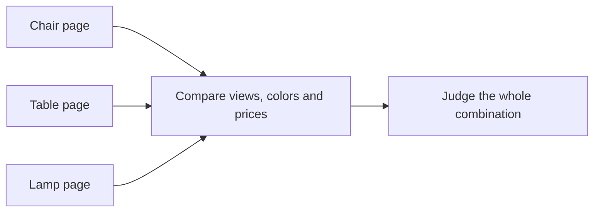
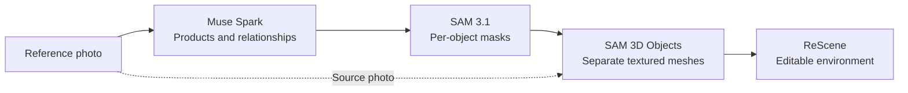
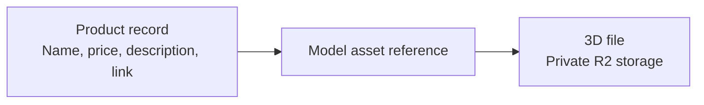
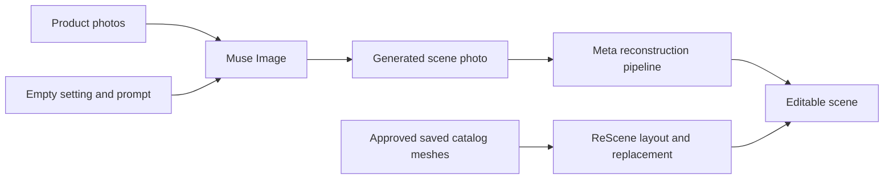
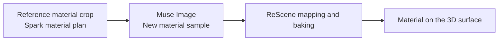
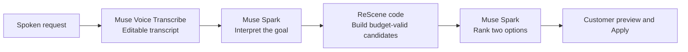

# ReScene visual storyboard

Revised November 2, 2026 to match the supplied 2:25.633 narration and planned2:55 edit. [VIDEO_TIMELINE.md](VIDEO_TIMELINE.md) is the timing authority; [VIDEO_SCRIPT.md](VIDEO_SCRIPT.md) contains the recorded words. All times here are edited-video times. The video alternates between explanatory graphics and evidence from the running app. Diagrams explain relationships and transformations; actual requests, results, Save/reload and editing interactions prove execution.

The organizer guidance Jim supplied says “not slides.” The proposed treatment uses brief annotations over actual app/code footage or genuine intermediate outputs, rather than a separate pitch deck. These are diagram sources and edit directions, not completed animations or recorded evidence. No inferred statistics or illustrative prices should be presented as measured results.

## Visual 1 — Separate information and a combined decision

**Use:** 0:00–0:17.5. Lead with the shopping problem, not an invented personal reaction to a chair.

Use crops from three actual product pages. Each contains the product image, available color and price. Highlight how the shopper compares information across pages, then reveal those same products together in the real 3D environment. Use one verified set throughout the reveal; do not substitute another collection.

The diagram is the composition logic for the edit, not a replacement product mockup. The visual contrast is between separate information and a combined decision. Suggested short annotation: **See your choices together.** Do not add a click counter or a time-saved claim without a measured comparison. Keep the build-history caption visible on the first frame, as specified in the script.

## Visual 2 — A photo becomes editable objects

**Use:** 0:31.1–0:49.1, followed by actual execution/result footage.

Reveal each stage in sync with its explanation. Replace generic boxes with the actual photo, object-plan highlights, masks and mesh thumbnails when the take is captured. Keep the model name and output together so viewers understand what changes at each step.

SAM 3D uses the photo and masks. ReScene's integration includes coordinate alignment, support/background constraints, material processing and editing. The shortened diagram is not an exhaustive API graph. Background depth/material work is explained separately; masks alone do not create the complete environment.

Return to the actual request, processing and matching result. An animated arrow is not evidence that a paid call ran. Keep real elapsed-time labels on processing cuts and identify hosted SAM 3D as a Meta model served by fal.

## Visual 3 — Product information stays linked to its model

**Use:** about three seconds inside the 1:06.65–1:18.65 Save/reload sequence.

Show a small relationship callout beside the selected object's product form. Use its actual saved name and price. Then remove the callout and reload the project so the viewer sees persistence in the working app.

Neon stores metadata and references; R2 stores the media bytes. Do not show raw SQL rows, UUIDs, connection strings or unrelated products. The production graphic can simplify this to a product card connected to a model thumbnail; the three-node source above preserves the implementation distinction.

## Visual 4 — Two different ways to use a catalog

**Use:** show the photo-reference lane during 1:18.65–1:33.95. Revisit only the direct-reuse lane at the start of Build your space.

Do not reveal every node at once in the video. The first lane explains the scene-photo generator. The second explains how an existing 3D catalog can be reused without generating replacement meshes. This distinction directly addresses the business use case without implying that Image Studio preserves original mesh geometry or that arbitrary merchant GLB/CAD upload is implemented.

The explanatory diagram gives way to the real Muse request/output, adoption and that image's reconstructed result. Keep the source-image transition visible.

## Visual 5 — A generated sample becomes a mapped material

**Use:** about four seconds inside 1:01.3–1:06.65, followed by a controlled before/after.

Use an actual source-material crop, an accepted generated sample and a close-up of the mapped result. Keep model lighting out of the material sample where possible; the explanation should distinguish source material from baked illumination. Do not imply that Muse Image outputs a UV-correct 3D model or faithfully recovers hidden logos/details. The workflow retains source/provider detail where appropriate, and plain surfaces may correctly remain plain.

Hold the real before/after at the same camera, light and placement. A generated material swatch by itself does not prove that mapping improved. Keep the move/color/light montage separate from this comparison. Label VGGT on its actual background depth footage, not on the recoloring operation.

## Visual 6 — A request becomes two validated choices

**Use:** a short decision-flow overlay inside 2:09–2:33.42, followed by the actual two-option comparison and Apply/Undo.

Introduce the goal and the kept product before this overlay. Code checks actual catalog prices, purchase scope, compatibility, kept/owned products and placement; final Apply is validated again against the current arrangement. The customer chooses application. Do not depict an autonomous checkout.

After actual results return, present a compact comparison using their real data. Useful fields are **changed products**, **merchandise subtotal**, **kept chair** and **remaining budget**. Keep the corresponding scene previews visible. Crop or annotate the real option cards, or derive a small table directly from those results; do not invent prices to complete the layout. A 3D preview is still needed to show how the options look.

Avoid a second full stylist inference in Shop the scene. Use that time to show product selection, replacement and the bag. A price bar is optional only if it plots the actual returned subtotals against the stated budget; conversion, time-saving or quality-improvement charts have no measured data for this script.

## Where app footage should dominate

- **Product inspection, 1:36.55–1:54.7:** rotation, finish preview and the album/3D switch need the actual product page. Short callouts can identify controls; a diagram would hide the experience being demonstrated.
- **Scene editing:** movement and lighting changes need genuine interaction. The material workflow diagram explains the hidden work, then the fixed-camera before/after shows the result.
- **Shop the scene, 2:33.42–2:45.7:** selecting a model must visibly reveal its product card; replacement and Shop this look must reach a real result. An abstract customer-journey diagram would duplicate what the app already makes clear.
- **Ending, 2:45.7–2:55:** hold the completed combination, subtotal, creator and URL. The result should resolve the opening problem without adding another explainer.

## Graphic production rules

Use a restrained ReScene palette, large output labels and a single highlighted stage at a time. Show concrete outputs before adding implementation detail. Do not place a dense six-model table, full schema or full architecture chart into a short narration segment. Introduce model names where viewers see their contributions.

Fit graphics inside the existing spoken sections. The model workflow has18seconds; the material explanation has about5seconds, and the stylist has a6-second option-reading hold. Use annotations over genuine app/output footage rather than inserting another silent architecture chapter. Use genuine intermediate outputs and readable technical evidence. The original uncut capture and request receipts remain available privately for provenance.
